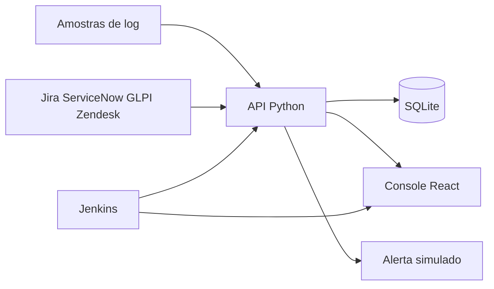

# Sentinela

Console de sustentação N1/N2. Ele lê log, abre incidente com procedimento e fornecedor, mede SLA de chamado e só ensaia limpeza ou reinício enquanto o modo seguro está ligado.

O laboratório sobe com SQLite, amostras locais e um catálogo fictício de Jira, ServiceNow, GLPI e Zendesk. A mesma API aceita token real quando você preenche o `.env`.

## Arquitetura



| Peça | Função |
| --- | --- |
| `backend/app/services/log_collector.py` | Varre `.log`, `.txt` e `.out`. Guarda ERROR, FATAL, CRITICAL e Exception. |
| `backend/app/services/incident_engine.py` | Agrupa pela assinatura, classifica P1–P3 e manda para N1 ou N2. |
| `backend/app/services/automation.py` | Lê disco e memória. Limpa só `data/sandbox`. Não reinicia serviço do sistema. |
| `backend/app/services/providers.py` | Traduz o chamado das quatro ferramentas. Sem token, usa o catálogo de demonstração. |
| `frontend/` | Console do operador. |
| `jenkins/Jenkinsfile` | Pytest e build do console. O relatório semanal é um parâmetro. |

## Subir no Windows

**Forma recomendada (sem erro):** rode `npm start` ou `npm run abrir` na raiz (ou duplo clique em `scripts/Abrir-Sentinela.cmd`). Isso sobe a API (8010), o console (5500) e abre o navegador. Guia curto: `docs/COMO-USAR.txt`.

Ou no terminal:

```powershell
powershell -ExecutionPolicy Bypass -File .\scripts\iniciar.ps1
```

No VS Code, ao abrir a pasta do projeto, a tarefa **Sentinela: garantir API** tenta subir o backend automaticamente (aceite tarefas automáticas quando o editor pedir). Você também pode usar **Terminal → Executar Tarefa de Compilação** (`Ctrl+Shift+B`) para `Sentinela: iniciar (API + bundle)`.

Fluxo clássico em dois terminais:

```powershell
powershell -ExecutionPolicy Bypass -File .\scripts\verificar.ps1
powershell -ExecutionPolicy Bypass -File .\scripts\subir-api.ps1
```

```powershell
cd frontend
npm install
npm run dev
```

Abra `http://127.0.0.1:5173`. A documentação da API fica em `http://127.0.0.1:8010/docs`.

### Live Server (VS Code)

O projeto já vem com `.vscode/settings.json` apontando a raiz do servidor para `frontend/` e **proxy** de `/api` para `http://127.0.0.1:8010`. O console no Live Server usa caminhos relativos (`/api/...`); a API precisa estar na porta **8010** — use `scripts\iniciar.ps1` ou deixe a tarefa automática ao abrir a pasta. A porta 8000 fica de fora de propósito: no Windows ela costuma estar ocupada pelo Docker Desktop/WSL.

1. Em `frontend`, gere o bundle uma vez (ou deixe em watch enquanto edita o React):

```powershell
cd frontend
npm run live:bundle
# ou: npm run live:bundle:watch
```

2. Abra `index.html` na **raiz do repositório** e use **Go Live** (extensão Live Server). O endereço deve ser `http://127.0.0.1:5500/index.html`.

O `index.html` carrega `frontend/live-bootstrap.js`: no Live Server ele usa o bundle em `frontend/live-dist/`; no `npm run dev` (Vite, porta **5173**) continua usando os fontes com JSX. Se a porta 5500 estiver ocupada, o Live Server pode usar 5501 ou 5502 — o bootstrap já cobre isso.

Mapa completo de pastas: `docs/estrutura-do-projeto.md`.

### GitHub Pages

O endereço `https://jorgeramalho.github.io/SuporteSustentacaoN1N2/` abre o console em **modo demonstração** (dados em `frontend/demo/api-snapshot.json`, sem API na nuvem). Atualize o snapshot com `scripts/export-demo.ps1` (com a API local na 8010) antes do commit. O laboratório completo continua em `npm start` e `http://127.0.0.1:5500/index.html` no seu PC.

### Vercel e incidentes que “não salvam”

Se o site público só mostra o console (por exemplo `https://suportesustentacaon1n2.vercel.app/`) e **Incidentes** não persiste, a causa é a ausência da API Python — não é bug do formulário. Depois do deploy com o bundle atual, o modo demo grava no **localStorage**; para banco compartilhado, publique a API (Render + `render.yaml`) e configure o `vercel.json`. Passo a passo: **`docs/deploy-publicacao.md`**.

### Feedback no console

| Faixa no topo | Significado |
| --- | --- |
| Verde (`notice`) | Operação concluída ou informação neutra (por exemplo, nada novo na fila). |
| Vermelha (`notice bad`) | Falha de API ao carregar a aba ou ao executar um botão. A mensagem tenta ser específica; se aparecer texto genérico, confira `/docs` e reinicie a API. |
| Vermelha fixa abaixo do cabeçalho | `/api/health` não respondeu — a API não está na porta **8010**. |

Depois de mudar o React, rode `npm run live:bundle` antes de recarregar o Live Server. Depois de mudar o Python, **reinicie** `scripts\subir-api.ps1` (uvicorn não recarrega sozinho se o processo antigo ainda estiver na 8010). Os links **Baixar CSV/JSON** em Logs usam `http://127.0.0.1:8010`, não a porta do Live Server.

Linha de comando, a partir de `backend`:

```powershell
.\.venv\Scripts\python.exe -m app.cli logs --export csv
.\.venv\Scripts\python.exe -m app.cli monitor --disk 96 --memory 93
.\.venv\Scripts\python.exe -m app.cli report --days 7
```

`logs` grava CSV ou JSON em `data/reports`. `monitor` imprime a decisão. `report` grava o compilado semanal. Com `SIMULATE=true`, nenhum dos três manda e-mail, Slack ou Telegram.

Docker (Compose em `deploy/`):

```powershell
npm run docker:up
```

O console empacotado fica em `http://127.0.0.1:8088` e a API em `http://127.0.0.1:8000`.

Jenkins, quando quiser mostrar o pipeline:

```powershell
npm run docker:jenkins
```

A primeira senha sai em `docker compose -f deploy/docker-compose.yml logs jenkins`. Configure o job com **Script Path** `jenkins/Jenkinsfile` (veja `jenkins/README.md`). No laboratório, o repositório monta em `/workspace`. No Windows, `scripts\verificar.ps1` executa os mesmos dois estágios: pytest e `npm run build`.

Copie `config\.env.example` para `.env` na raiz só quando for ligar SMTP, Slack, Telegram ou uma ferramenta real. O padrão já é modo seguro.

## O que dizer em cinco minutos

1. Abra o **Painel**. Os serviços mudam de estado conforme o incidente aberto. O disco e a memória são a leitura desta máquina.
2. Em **Logs**, mostre que INFO não entra e baixe o CSV. Aperte **Ler amostras** de novo: nada é duplicado.
3. Em **Incidentes**, abra um procedimento. Pool do Oracle vai para N2 com o fornecedor. Fila de e-mail congelada fica no N1 porque já tem artigo e a severidade é P3.
4. Em **Automação**, aperte **Ensaiar pressão**. O alerta nasce com `[SIMULADO]`. Os arquivos em `data/sandbox/temp` continuam lá. O texto diz que o sistema operacional não foi alterado.
5. Em **Chamados**, gere o relatório. Ele traz abertos, fechados, MTTR, primeira resposta e conformidade. Sem token, a origem é o catálogo local.
6. Feche no **`jenkins/Jenkinsfile`**: o pipeline testa o backend e compila o console. O relatório semanal é opcional, no parâmetro `GERAR_RELATORIO`.

O roteiro falado está em `docs/roteiro-entrevista.md`.

## Travas

| Situação | Efeito |
| --- | --- |
| `SIMULATE=true` | Grava o que faria. Não apaga arquivo, não envia rede. |
| `SIMULATE=false` e `ALLOW_REAL_ACTIONS=false` | Recusa a limpeza. |
| As duas travas liberadas | Apaga somente arquivos dentro de `data/sandbox`. |
| Reinício de serviço | Nunca é enviado ao Windows ou ao Linux. O registro fica para o operador. |
| API de logs | Só lê pasta dentro de `data/`. A CLI recusa a raiz do disco e `System32`. |

## Testes

```powershell
cd backend
.\.venv\Scripts\python.exe -m pytest
```

A suíte cobre o filtro de log, a conta de SLA, a sandbox, o mapeamento de Jira e GLPI, e o fluxo da API.

## Fora deste laboratório

Login, PostgreSQL e agente em vários hosts ficam para uma segunda conversa. O banco troca pela `DATABASE_URL` (`postgresql+psycopg://...`) porque o acesso é SQLAlchemy. O reinício real de serviço ficou de fora de propósito: em sustentação, ensaio e trilha vêm antes do comando no servidor.
