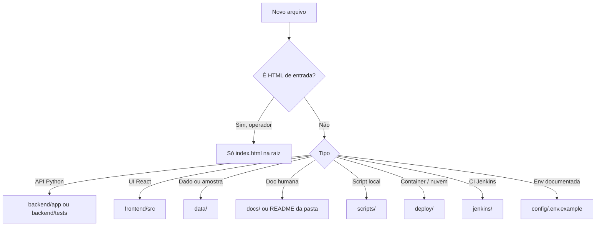

# Organização e padrões do repositório

Documento de referência para **estrutura**, **responsabilidades** e **onde criar arquivos novos**. Complementa o mapa arquivo a arquivo em [estrutura-do-projeto.md](./estrutura-do-projeto.md).

## Objetivos

1. **Raiz enxuta** — o operador encontra um único ponto de entrada web: `index.html`.
2. **Um arquivo, uma pasta** — cada artefato fica na pasta da sua responsabilidade, com `README.md` local.
3. **Documentação centralizada** — visão do produto e guias em `docs/`; detalhes por área nas subpastas.

## Regra da raiz (`/`)

| O que fica na raiz | Motivo |
| --- | --- |
| `index.html` | Único HTML de entrada (Live Server `:5500`, GitHub Pages, Vercel estático). |
| `.gitignore`, `.dockerignore`, `.editorconfig` | Convenção das ferramentas (Git, Docker, editor). Não são “conteúdo” do produto. |
| `.env` (opcional, não versionado) | FastAPI lê variáveis na raiz por compatibilidade com `backend/app/config.py`. |
| `.github/`, `.vscode/` | Metadados de CI e editor (pastas ocultas). |

**Não** manter na raiz: `README.md`, `package.json`, `render.yaml`, `vercel.json`, atalhos `.bat`, workspaces, relatórios soltos ou caches de agente.

## Árvore lógica

```text
/
├── index.html              ← entrada web (único arquivo “visível” na raiz)
├── backend/                ← API FastAPI + testes
├── config/                 ← modelo .env, atalhos npm, workspace multi-pasta
├── data/                   ← SQLite, amostras, relatórios, sandbox
├── deploy/                 ← Compose, Render, Vercel
├── docs/                   ← documentação do produto e da estrutura
├── frontend/               ← console React, Vite, bundles
├── jenkins/                ← pipeline CI
└── scripts/                ← automação Windows (PowerShell / .cmd)
```

## Fluxo de decisão (arquivo novo)



## Atalhos npm (sem `package.json` na raiz)

O manifesto fica em `config/package.json`. Na raiz do repositório:

```powershell
npm --prefix config start
npm --prefix config run abrir
npm --prefix config run docker:up
```

Equivalente: `scripts\Abrir-Sentinela.cmd` ou os `.ps1` listados em [scripts/README.md](../scripts/README.md).

## Publicação em nuvem

| Plataforma | Arquivo canônico | Observação |
| --- | --- | --- |
| Render Blueprint | `deploy/render.yaml` | O Render exige `render.yaml` na **raiz** ao importar Blueprint. Copie deste arquivo ou crie o serviço manualmente seguindo o mesmo conteúdo. |
| Vercel (proxy `/api`) | `deploy/vercel.json` | A Vercel detecta `vercel.json` na raiz do deploy. Copie para a raiz **só no momento do deploy** ou configure rewrites no painel. |
| GitHub Pages | `index.html` + `frontend/live-dist/` | Workflow em `.github/workflows/github-pages-bundle.yml`. |

Detalhes: [deploy-publicacao.md](./deploy-publicacao.md) e [deploy/README.md](../deploy/README.md).

## Manutenção

- Ao adicionar pasta ou arquivo relevante, atualize o `README.md` **da pasta** e, se mudar a regra global, este arquivo e `estrutura-do-projeto.md`.
- Artefatos locais de IDE/agente (`_*_host_*.json`, relatórios de chat) não entram no Git — ver `.gitignore`.

## Leitura recomendada

| Ordem | Documento |
| --- | --- |
| 1 | [PROJETO.md](./PROJETO.md) — visão, arquitetura, como subir |
| 2 | [COMO-USAR.txt](./COMO-USAR.txt) — passos mínimos no editor |
| 3 | [estrutura-do-projeto.md](./estrutura-do-projeto.md) — tabelas por pasta |
| 4 | README de cada pasta (`config`, `deploy`, `scripts`, …) |
